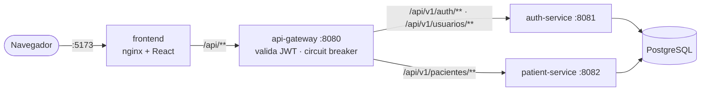

# 🏥 HealthSys Distribuído

[](docs/diagrams/arquitetura.md)
[](docker-compose.yml)
[](#)
[](#-status-da-sprint-2-semanas-34)

Plataforma de Gestão Hospitalar baseada em Arquitetura Distribuída, desenvolvida para apoiar hospitais no gerenciamento de pacientes, prontuários eletrônicos e triagens médicas com foco em alta disponibilidade e tolerância a falhas.

---

## 📁 Estrutura do Repositório

- **`docs/`**: Documentação técnica de arquitetura, diagramas (Arquitetura, Fluxo, Modelo de Dados) e relatórios.
- **`services/`**: Código-fonte de cada microsserviço independente (Spring Boot).
  - `api-gateway`: Ponto único de entrada da API (Spring Cloud Gateway): roteamento, validação de JWT e circuit breaker. ✅
  - `auth-service`: Cadastro de usuários, login e emissão de tokens JWT (PostgreSQL). ✅
  - `patient-service`: Gestão cadastral de pacientes (PostgreSQL). ✅
  - `record-service`: Prontuário eletrônico e exames (MongoDB).
  - `triage-service`: Teletriagem e classificação de risco (Kafka/PostgreSQL).
  - `notification-service`: Notificações assíncronas (Kafka/WebSocket).
- **`frontend/`**: Aplicação cliente (React + Vite, servida por nginx). ✅ *Login, cadastro de pacientes e cadastro de usuários.*
- **`infra/`**:
  - `docker/`: Configurações adicionais de containers.
  - `db/`: Scripts de inicialização automática de banco de dados (`postgres-init` e `mongo-init`).
  - `k8s/`: Manifests de deployment e serviços para Kubernetes.

---

## 🧭 Como as peças conversam



1. O usuário faz login: o **auth-service** confere a senha (BCrypt) e devolve um **token JWT** assinado (HS256, válido por 8 h) com o id, o nome e o **perfil** do usuário.
2. O frontend envia o token em todas as chamadas (`Authorization: Bearer <token>`).
3. O **api-gateway** barra na borda qualquer requisição sem token válido (exceto o login) e encaminha as demais para o serviço certo.
4. Cada microsserviço **valida o token de novo, localmente**, com o mesmo segredo (`JWT_SECRET`), e aplica as regras de perfil. Não há chamada ao auth-service a cada requisição, então o `patient-service` continua atendendo mesmo se o `auth-service` cair (sem ponto único de falha na autenticação).
5. Se um serviço fica fora do ar, o **circuit breaker** do gateway (Resilience4j) responde `503` na hora, em vez de deixar o usuário esperando. Com 50% de falhas nas últimas 10 chamadas o circuito abre por 10 s, dando tempo para o serviço se recuperar.

### Permissões por perfil

| Ação | ADMIN | MEDICO | ENFERMEIRO |
| :--- | :---: | :---: | :---: |
| Cadastrar / listar / editar pacientes | ✅ | ✅ | ✅ |
| Excluir paciente | ✅ | ❌ | ❌ |
| Gerenciar usuários | ✅ | ❌ | ❌ |

---

## 🚀 Como Executar Localmente

Toda a stack (bancos, cache, monitoramento, backend e frontend) é containerizada. Não é preciso instalar banco de dados, Java, Maven ou Node.js na máquina: a compilação do backend e o build do frontend acontecem dentro do Docker.

### Pré-requisitos
- [Docker Desktop](https://www.docker.com/products/docker-desktop) instalado e em execução (Status: *Engine running*).
- Terminal (PowerShell, Bash ou CMD).

### 1. Iniciar os Serviços
Na raiz do repositório, execute o comando abaixo para montar as imagens e subir tudo em segundo plano:
```bash
docker compose up -d --build
```
> Na primeira execução o build leva alguns minutos (download das dependências Maven e npm). Os testes automatizados de cada serviço rodam durante o build; se algum falhar, a imagem não é gerada.

> Quem já tinha o banco criado pela versão anterior **não precisa** apagar o volume: o `patient-service` adiciona as colunas novas sozinho e o `auth-service` converte a senha do admin antigo para hash BCrypt.

### 2. Verificar o Status
Verificar se todos os containers subiram corretamente:
```bash
docker compose ps
```

### 3. Acessos e Credenciais

**Login padrão do sistema:** `admin@healthsys.com` / `admin123` (criado automaticamente pelo `auth-service`; pode ser alterado pelas variáveis `ADMIN_EMAIL` e `ADMIN_SENHA`).

| Serviço | Endereço | Usuário / Admin | Senha | Database Interno |
| :--- | :--- | :--- | :--- | :--- |
| **Frontend (Web)** | `http://localhost:5173` | `admin@healthsys.com` | `admin123` | - |
| **API Gateway** | `http://localhost:8080` | - | - | - |
| **Auth Service (API)** | `http://localhost:8081` · Swagger: `/swagger-ui.html` | - | - | `healthsys_db` |
| **Patient Service (API)** | `http://localhost:8082` · Swagger: `/swagger-ui.html` | - | - | `healthsys_db` |
| **PostgreSQL** | `localhost:5432` | `healthuser` | `healthpass` | `healthsys_db` |
| **MongoDB** | `localhost:27017` | `mongouser` | `mongopass` | `healthsys_records` |
| **Redis** | `localhost:6379` | - | - | - |
| **Grafana** | `http://localhost:3000`| `admin` | `admin` | - |
| **Prometheus** | `http://localhost:9090`| - | - | - |

> **Portas:** o frontend usa a `5173` (padrão do Vite) porque a `3000` já é do Grafana. A `8080` é do API Gateway; os microsserviços são numerados a partir da `8081`.

> **Swagger:** abra `http://localhost:8081/swagger-ui.html`, execute o `POST /api/v1/auth/login`, copie o `token` e cole no botão **Authorize**. O mesmo token funciona no Swagger do `patient-service` (8082).

> **Segredo do JWT:** o valor padrão serve só para desenvolvimento. Para trocar, crie um arquivo `.env` na raiz com `JWT_SECRET=<no mínimo 32 caracteres>`; o docker-compose repassa o mesmo valor aos três serviços.

> *Dica: Utilizaremos ferramentas como **DBeaver** ou **MongoDB Compass** para visualizar os dados.*

### 4. Parar e Limpar os Serviços
Para pausar os containers temporariamente sem perder os dados:
```bash
docker compose down
```

**⚠️ Reset Completo:** Caso queiramos alterar os arquivos de inicialização (`init.sql` ou `init-mongo.js`) e recriar o banco do zero (apagando todos os dados), utilizaremos a flag `-v`:
```bash
docker compose down -v
```
No próximo `docker compose up -d`, os bancos serão recriados novinhos em folha.

---

## 🔌 API REST

Todas as rotas são acessadas pelo gateway (`http://localhost:8080`) ou pelo frontend (`http://localhost:5173`, repassado pelo nginx). Exceto o login, todas exigem o header `Authorization: Bearer <token>`.

Erros seguem o formato padrão RFC 7807 (*Problem Details*). Erros de validação trazem o campo `erros` com a mensagem de cada campo. `401` = token ausente/inválido/expirado; `403` = perfil sem permissão; `503` = serviço fora do ar (resposta do circuit breaker).

### 🔐 Autenticação (`auth-service`)

| Método | Rota | Acesso | Descrição | Sucesso | Erros |
| :--- | :--- | :--- | :--- | :--- | :--- |
| `POST` | `/api/v1/auth/login` | Público | Troca e-mail e senha por um token JWT | `200` | `400`, `401` credenciais inválidas |
| `GET` | `/api/v1/auth/me` | Autenticado | Dados do usuário dono do token | `200` | `401` |

```json
// POST /api/v1/auth/login
{ "email": "admin@healthsys.com", "senha": "admin123" }

// resposta
{
  "token": "eyJhbGciOiJIUzI1NiJ9...",
  "tipo": "Bearer",
  "expiraEm": "2026-11-05T02:00:00Z",
  "usuario": { "id": 1, "nome": "Administrador", "email": "admin@healthsys.com", "perfil": "ADMIN", "criadoEm": "..." }
}
```

### 👤 Usuários (`auth-service`, somente ADMIN)

| Método | Rota | Descrição | Sucesso | Erros |
| :--- | :--- | :--- | :--- | :--- |
| `POST` | `/api/v1/usuarios` | Cadastra um usuário | `201` + header `Location` | `400` dados inválidos, `409` e-mail já cadastrado |
| `GET` | `/api/v1/usuarios` | Lista todos os usuários | `200` | - |
| `GET` | `/api/v1/usuarios/{id}` | Busca um usuário | `200` | `404` |
| `PUT` | `/api/v1/usuarios/{id}` | Atualiza (senha opcional; nula mantém a atual) | `200` | `400`, `404`, `409` |
| `DELETE` | `/api/v1/usuarios/{id}` | Remove um usuário | `204` | `404`, `409` ao tentar excluir a si mesmo |

```json
{ "nome": "Dra. Ana Souza", "email": "ana@hospital.com", "senha": "senhaForte123", "perfil": "MEDICO" }
```

- `perfil` aceita `ADMIN`, `MEDICO` ou `ENFERMEIRO`.
- E-mails são normalizados para minúsculas e devem ser únicos.
- Senhas têm de 8 a 72 caracteres e são gravadas apenas como hash **BCrypt**; nenhuma resposta da API devolve a senha.

### 🩺 Pacientes (`patient-service`)

| Método | Rota | Acesso | Descrição | Sucesso | Erros |
| :--- | :--- | :--- | :--- | :--- | :--- |
| `POST` | `/api/v1/pacientes` | Todos os perfis | Cadastra um paciente | `201` + header `Location` | `400`, `409` CPF já cadastrado |
| `GET` | `/api/v1/pacientes?busca=` | Todos os perfis | Lista em ordem alfabética; `busca` filtra por trecho do nome ou início do CPF | `200` | - |
| `GET` | `/api/v1/pacientes/{id}` | Todos os perfis | Busca um paciente | `200` | `404` |
| `PUT` | `/api/v1/pacientes/{id}` | Todos os perfis | Atualiza um paciente | `200` | `400`, `404`, `409` |
| `DELETE` | `/api/v1/pacientes/{id}` | Somente ADMIN | Remove um paciente | `204` | `403`, `404` |

```json
{
  "nome": "Maria da Silva",
  "cpf": "529.982.247-25",
  "dataNascimento": "1990-05-15",
  "sexo": "F",
  "telefone": "(85) 98888-0001",
  "email": "maria@email.com",
  "endereco": "Rua das Flores, 100 - Fortaleza/CE"
}
```

- Obrigatórios: `nome`, `cpf`, `dataNascimento` (formato `AAAA-MM-DD`, não pode estar no futuro) e `sexo` (`M`, `F` ou `O`).
- O CPF é aceito com ou sem pontuação, tem os dígitos verificadores conferidos, é gravado só com números e deve ser único.
- A resposta inclui a `idade`, calculada a partir da data de nascimento.

### Health checks
`GET /actuator/health` em cada serviço (`8080`, `8081`, `8082`) — público.

---

## 📌 Status da Sprint 2 (Semanas 3–4)

| Item | Situação |
| :--- | :--- |
| Implementação do serviço de usuários | ✅ `auth-service`: CRUD de usuários com BCrypt e perfis |
| Implementação do serviço de pacientes | ✅ `patient-service`: CRUD de pacientes com validação de CPF e busca |
| Implementação do serviço de autenticação | ✅ Login com JWT, autorização por perfil em cada serviço |
| Criação da API REST | ✅ Rotas REST versionadas (`/api/v1`), erros RFC 7807, Swagger e API Gateway |
| Desenvolvimento inicial do frontend | ✅ Login, cadastro de pacientes e de usuários (React) |

**Entregáveis:** sistema com cadastro de usuários ✅ · sistema com cadastro de pacientes ✅ · primeira versão da interface web ✅
