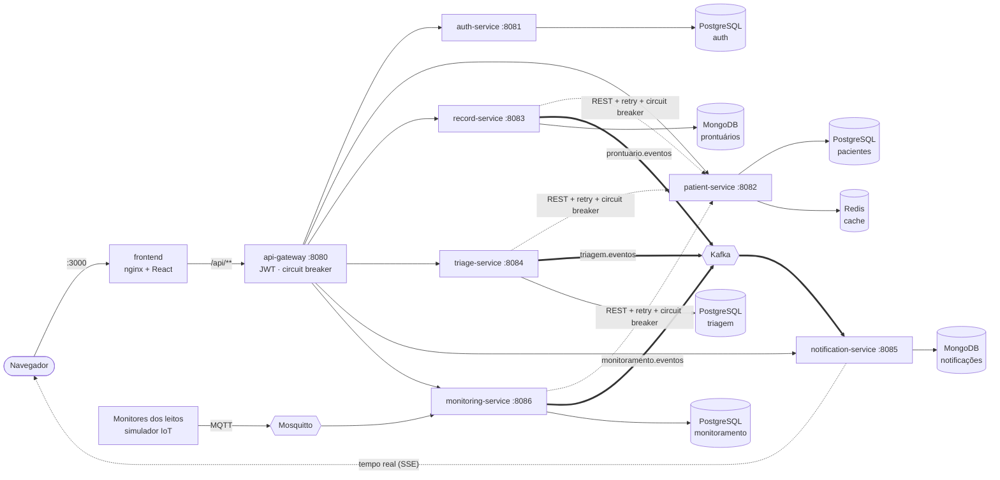

# 🏥 HealthSys Distribuído

[](#-como-as-peças-conversam)
[](docker-compose.yml)
[](#-status-do-projeto)
[](#-status-do-projeto)

Plataforma de Gestão Hospitalar baseada em Arquitetura Distribuída, desenvolvida para apoiar hospitais no gerenciamento de pacientes, prontuários eletrônicos, triagens e leitos, com foco em alta disponibilidade e tolerância a falhas.

> Projeto acadêmico. Os limites de alerta dos sinais vitais são simplificados, só para demonstração, e o ambiente usa senhas de desenvolvimento. Num hospital de verdade, os limites seguem o protocolo clínico da instituição e o sistema precisaria de homologação, HTTPS, gestão de segredos e adequação à LGPD.

---

## 📁 Estrutura do Repositório

- **`services/`**: um microsserviço Spring Boot (Java 17) por pasta, cada um com o seu banco.
  - `api-gateway` (8080): ponto único de entrada: roteamento, validação do JWT e circuit breaker. ✅
  - `auth-service` (8081): usuários, perfis e login com JWT (PostgreSQL). ✅
  - `patient-service` (8082): cadastro de pacientes e ficha clínica (PostgreSQL + cache Redis). ✅
  - `record-service` (8083): prontuário eletrônico: consultas, exames e medicamentos (MongoDB). ✅
  - `triage-service` (8084): fila de triagem e classificação de risco (PostgreSQL). ✅
  - `notification-service` (8085): notificações assíncronas: consome o Kafka e avisa em tempo real (MongoDB). ✅
  - `monitoring-service` (8086): leitos, ocupação, sinais vitais via MQTT (IoT) e alertas (PostgreSQL). ✅
- **`frontend/`**: aplicação web (React + Vite, servida por nginx). ✅
- **`infra/`**:
  - `db/`: scripts de inicialização dos bancos.
  - `mqtt/`: configuração do broker MQTT (Mosquitto).
  - `iot-simulator/`: simulador dos monitores dos leitos (Python), que publica sinais vitais via MQTT.
  - `monitoring/`: Prometheus (coleta de métricas e alertas) e Grafana (painel "HealthSys" já pronto).
  - `k8s/`: reservado para o deploy em Kubernetes (semanas 7–8).
- **`testes-falhas/`**: script que derruba cada peça do sistema e confere que o resto continua funcionando.
- **`docs/`**: diagramas e documentação de arquitetura.

---

## 🧭 Como as peças conversam



1. **Login:** o `auth-service` confere a senha (BCrypt) e devolve um token JWT (HS256, 8 h) com o id, o nome e o perfil.
2. **Toda chamada** leva o token. O gateway barra quem não tem token válido, e **cada serviço confere o token de novo, localmente**: se o `auth-service` cair, quem já está logado continua trabalhando.
3. **Comunicação síncrona (REST):** prontuário, triagem e monitoramento perguntam ao `patient-service` se o paciente existe, repassando o token.
4. **Comunicação assíncrona (Kafka):** cada mudança importante vira um **evento**. O `notification-service` consome os eventos e avisa quem precisa agir, em tempo real.
5. **IoT (MQTT):** os monitores dos leitos publicam os sinais vitais a cada 3 segundos; o `monitoring-service` mostra ao vivo e gera alertas.
6. **Banco por serviço (RNF09):** nenhum serviço lê o banco do outro.

### Permissões por perfil

Pensadas como num hospital: a recepção abre a ficha e coloca o paciente na fila, a enfermagem faz a triagem, aplica vacinas e cuida dos leitos, o médico atende, pede exames e prescreve, e o dado clínico só é visto por profissionais de saúde (RN18, RNF17).

| Ação | ADMIN | RECEPCIONISTA | MEDICO | ENFERMEIRO |
| :--- | :---: | :---: | :---: | :---: |
| Gerenciar usuários (RF01) | ✅ | ❌ | ❌ | ❌ |
| Buscar pacientes e ver dados cadastrais (RF04) | ✅ | ✅ | ✅ | ✅ |
| Cadastrar e editar dados do paciente (RF03, RF05) | ❌ | ✅ | ❌ | ❌ |
| Excluir paciente (só se não tiver registros clínicos) | ✅ | ❌ | ❌ | ❌ |
| Ver histórico clínico, alergias, vacinas e atendimentos (RF07) | ❌ | ❌ | ✅ | ✅ |
| Registrar atendimento (RF06) | ❌ | ❌ | ✅ | ❌ |
| Registrar vacina aplicada (RF09) | ❌ | ❌ | ❌ | ✅ |
| Registrar alergia (RF08) | ❌ | ❌ | ✅ | ✅ |
| Registrar consulta no prontuário (RF10) | ❌ | ❌ | ✅ | ❌ |
| Solicitar exame (RF11) | ❌ | ❌ | ✅ | ❌ |
| Registrar resultado de exame (RF12) | ❌ | ❌ | ✅ | ✅ |
| Prescrever e suspender medicamento (RF13) | ❌ | ❌ | ✅ | ❌ |
| Abrir triagem (colocar o paciente na fila) | ❌ | ✅ | ❌ | ✅ |
| Ver a fila de triagem | ❌ | ✅ (sem sinais vitais) | ✅ | ✅ |
| Avaliar sinais vitais e classificar risco (RF15, RF16) | ❌ | ❌ | ❌ | ✅ |
| Chamar para atendimento e finalizar triagem | ❌ | ❌ | ✅ | ❌ |
| Cancelar triagem (ex.: paciente desistiu) | ❌ | ✅ | ✅ | ✅ |
| Ver a ocupação dos leitos | ✅ (sem nome do paciente) | ✅ | ✅ | ✅ |
| Cadastrar e remover leitos | ✅ | ❌ | ❌ | ❌ |
| Internar e dar alta do leito | ❌ | ❌ | ✅ | ✅ |
| Confirmar a higienização do leito | ❌ | ❌ | ❌ | ✅ |
| Ver sinais vitais ao vivo e reconhecer alertas | ❌ | ❌ | ✅ | ✅ |
| Receber notificações | ❌ | ✅ | ✅ | ✅ |

As regras ficam no servidor (`SecurityConfig` de cada serviço); a tela só esconde o que o perfil não pode usar (`frontend/src/permissoes.js`).

---

## 📨 Mensageria (Kafka)

| Tópico | Quem publica | Eventos |
| :--- | :--- | :--- |
| `triagem.eventos` | triage-service | `TRIAGEM_ABERTA`, `TRIAGEM_AVALIADA`, `TRIAGEM_STATUS_ALTERADO` |
| `prontuario.eventos` | record-service | `CONSULTA_REGISTRADA`, `EXAME_SOLICITADO`, `EXAME_RESULTADO_REGISTRADO`, `MEDICAMENTO_PRESCRITO`, `MEDICAMENTO_SUSPENSO` |
| `monitoramento.eventos` | monitoring-service | `ALERTA_SINAIS_VITAIS`, `LEITO_OCUPADO`, `LEITO_LIBERADO`, `LEITO_HIGIENIZADO` |
| `*.DLT` | notification-service | Mensagens que falharam 5 vezes (dead letter topic), para análise |

Todos os eventos têm o mesmo formato:

```json
{
  "eventoId": "b95ce51e-19fa-45f6-ab87-aac687393405",
  "tipo": "TRIAGEM_AVALIADA",
  "origem": "triage-service",
  "ocorridoEm": "2026-11-22T10:00:00Z",
  "pacienteId": 1,
  "pacienteNome": "Maria Silva",
  "autor": { "id": 8, "nome": "Enf. Bruno", "perfil": "ENFERMEIRO" },
  "dados": { "triagemId": 10, "classificacaoRisco": "CRITICO" }
}
```

- **Nenhum evento se perde (caixa de saída / transactional outbox):** o evento é gravado no banco do serviço junto com a mudança. Um publicador envia para o Kafka a cada 2 segundos e só marca como enviado depois da confirmação. Se o Kafka estiver fora, os eventos esperam e são enviados quando ele volta.
- **Ordem:** a chave da mensagem é o id do paciente, então os eventos de um mesmo paciente chegam na ordem.
- **Sem repetição:** a entrega é "pelo menos uma vez"; o `notification-service` usa o `eventoId` como id da notificação, então um evento repetido não gera aviso duplicado.
- **Mensagem com defeito:** tenta 5 vezes e vai para o tópico `.DLT`, sem travar a fila.
- Para ver os tópicos e as mensagens: **Kafka UI** em http://localhost:8090.

## 📡 IoT: monitores dos leitos (MQTT)

- Cada monitor publica no tópico `healthsys/leitos/<CÓDIGO>/sinais` (ex.: `healthsys/leitos/UTI-01/sinais`):
  `{"frequenciaCardiaca":82,"saturacao":97,"temperatura":36.8,"pressaoSistolica":120,"pressaoDiastolica":80,"medidoEm":"..."}`
- O `iot-simulator` simula os 12 leitos iniciais (UTI-01 a 04, ENF-01 a 06, EMG-01 e 02). De vez em quando um paciente "piora" sozinho. Para provocar de propósito:
  `docker exec healthsys-mosquitto mosquitto_pub -t healthsys/simulador/comando -m "piorar UTI-01"` (e `"normalizar UTI-01"` para voltar).
- O `monitoring-service` só acompanha leitos **ocupados**, guarda a última leitura em memória e grava apenas os alertas.
- Limites usados (simplificados para demonstração):

| Sinal | Atenção | Crítico |
| :--- | :--- | :--- |
| Saturação (SpO₂) | abaixo de 94% | abaixo de 90% |
| Frequência cardíaca | acima de 110 ou abaixo de 50 bpm | acima de 130 ou abaixo de 40 bpm |
| Temperatura | 38,0 °C ou mais, ou abaixo de 35 °C | 39,5 °C ou mais, ou abaixo de 34 °C |
| Pressão sistólica | 160 ou mais, ou abaixo de 90 mmHg | 180 ou mais, ou abaixo de 80 mmHg |

- Sem "chuva de alertas": um alerta aberto não se repete a cada leitura; só um novo se piorar de Atenção para Crítico. Depois de reconhecido, espera 5 minutos antes de repetir.
- Monitor sem mandar leitura há mais de 15 segundos: a tela mostra "sem sinal do monitor".

## 🛡️ Resiliência e tolerância a falhas

| Mecanismo | Onde | O que faz |
| :--- | :--- | :--- |
| Circuit breaker | Gateway (uma rota por serviço) | Serviço fora: responde `503` na hora. Com 50% de falhas nas últimas 10 chamadas, abre por 10 s e depois testa com 2 chamadas. |
| Timeout + nova tentativa + circuit breaker | Prontuário, triagem e monitoramento → pacientes | Timeout de 2 s para conectar e 3 s para responder; 3 tentativas só em falha de rede ou 5xx; circuito abre com 50% de falhas. "Paciente não encontrado" não conta como falha. |
| Caixa de saída (outbox) | Triagem, prontuário e monitoramento | Kafka fora: os eventos ficam guardados e são enviados depois. |
| Consumidor com DLT | Notificações | Mensagem com problema vai para o `.DLT` depois de 5 tentativas. |
| Cache tolerante | Pacientes | Redis fora: lê direto do PostgreSQL. |
| Reconexão automática | Monitoramento e simulador | Broker MQTT fora: tentam de novo a cada poucos segundos. |
| Tela em tempo real com plano B | Site | Canal de notificações caiu: reconecta sozinho e, enquanto isso, confere a lista a cada 30 s. |
| Validação local do JWT | Todos os serviços | Login fora: quem já está logado continua trabalhando. |

Os testes estão em [`testes-falhas/`](testes-falhas/LEIA-ME.md): um script derruba cada peça e confere o comportamento (cenários A a G), e há testes automáticos de resiliência em cada serviço.

## 📊 Monitoramento (Prometheus e Grafana)

- **Grafana:** http://localhost:3001 (admin / admin). O painel **HealthSys** abre direto e mostra: serviços no ar, requisições por segundo, tempo de resposta (p95), erros 5xx, estado dos circuit breakers, fila da triagem por risco, ocupação dos leitos, alertas dos monitores, eventos esperando o Kafka, notificações e memória.
- **Prometheus:** http://localhost:9090. Coleta `/actuator/prometheus` de todos os serviços a cada 10 s. Alertas em http://localhost:9090/alerts: serviço fora do ar, circuito aberto, eventos acumulados sem Kafka, monitores desconectados e muitos erros 5xx.
- **Kafka UI:** http://localhost:8090.

---

## 🚀 Como Executar Localmente

Toda a stack (bancos, cache, monitoramento, backend e frontend) é containerizada. Não é preciso instalar banco de dados, Java, Maven ou Node.js na máquina: a compilação do backend e o build do frontend acontecem dentro do Docker.

### Pré-requisitos
- [Docker Desktop](https://www.docker.com/products/docker-desktop) instalado e em execução (Status: *Engine running*).
- Terminal (PowerShell, Bash ou CMD).

### 1. Iniciar os Serviços
Na raiz do repositório, execute o comando abaixo para montar as imagens e subir tudo em segundo plano:
```bash
docker compose up -d --build
```
> Na primeira execução o build leva alguns minutos (download das dependências Maven e npm). Os testes automatizados de cada serviço rodam durante o build; se algum falhar, a imagem não é gerada.

> **Bancos separados:** cada serviço tem o seu banco. Se você já subiu uma versão anterior do projeto, rode `docker compose down -v --remove-orphans` antes de subir de novo (isso apaga os dados de teste).

> **Memória:** são 20 containers (7 serviços Java, 4 PostgreSQL, MongoDB, Redis, Kafka, Kafka UI, Mosquitto, simulador, Prometheus, Grafana e o site). Reserve pelo menos 8 GB de memória para o Docker Desktop (Settings → Resources).

### 2. Verificar o Status
Verificar se todos os containers subiram corretamente:
```bash
docker compose ps
```

### 3. Acessos e Credenciais

**Login padrão do sistema:** `admin@healthsys.com` / `admin123` (criado automaticamente pelo `auth-service`; pode ser alterado pelas variáveis `ADMIN_EMAIL` e `ADMIN_SENHA`).

| Serviço | Endereço | Usuário / Admin | Senha | Database Interno |
| :--- | :--- | :--- | :--- | :--- |
| **Frontend (Web)** | `http://localhost:3000` | `admin@healthsys.com` | `admin123` | - |
| **API Gateway** | `http://localhost:8080` | - | - | - |
| **Auth Service (API)** | `http://localhost:8081` · Swagger: `/swagger-ui.html` | - | - | `healthsys_auth` |
| **Patient Service (API)** | `http://localhost:8082` · Swagger: `/swagger-ui.html` | - | - | `healthsys_patients` |
| **Record Service (API)** | `http://localhost:8083` · Swagger: `/swagger-ui.html` | - | - | `healthsys_records` |
| **Triage Service (API)** | `http://localhost:8084` · Swagger: `/swagger-ui.html` | - | - | `healthsys_triage` |
| **Notification Service (API)** | `http://localhost:8085` · Swagger: `/swagger-ui.html` | - | - | `healthsys_notifications` |
| **Monitoring Service (API)** | `http://localhost:8086` · Swagger: `/swagger-ui.html` | - | - | `healthsys_monitoring` |
| **PostgreSQL (auth)** | `localhost:5432` | `auth_user` | `auth_pass` | `healthsys_auth` |
| **PostgreSQL (pacientes)** | `localhost:5433` | `patient_user` | `patient_pass` | `healthsys_patients` |
| **PostgreSQL (triagem)** | `localhost:5434` | `triage_user` | `triage_pass` | `healthsys_triage` |
| **PostgreSQL (monitoramento)** | `localhost:5435` | `monitoring_user` | `monitoring_pass` | `healthsys_monitoring` |
| **Kafka UI** | `http://localhost:8090` | - | - | - |
| **MQTT (Mosquitto)** | `localhost:1883` | sem senha (só desenvolvimento) | - | - |
| **MongoDB** | `localhost:27017` | `mongouser` | `mongopass` | `healthsys_records` e `healthsys_notifications` |
| **Redis** | `localhost:6379` | - | - | - |
| **Grafana** | `http://localhost:3001`| `admin` | `admin` | - |
| **Prometheus** | `http://localhost:9090`| - | - | - |

> **Portas:** o site usa a `3000` e o Grafana a `3001`. A `8080` é do API Gateway; os microsserviços vão de `8081` a `8086`.

> **Swagger:** abra `http://localhost:8081/swagger-ui.html`, execute o `POST /api/v1/auth/login`, copie o `token` e cole no botão **Authorize**. O mesmo token funciona no Swagger dos outros serviços (8082 a 8086).

> **Segredo do JWT:** o valor padrão serve só para desenvolvimento. Para trocar, crie um arquivo `.env` na raiz com `JWT_SECRET=<no mínimo 32 caracteres>`; o docker-compose repassa o mesmo valor a todos os serviços. Os containers Java usam o fuso `America/Sao_Paulo`, para que as datas e horas fiquem no horário de Brasília.

> *Dica: Utilizaremos ferramentas como **DBeaver** ou **MongoDB Compass** para visualizar os dados.*

### 4. Parar e Limpar os Serviços
Para pausar os containers temporariamente sem perder os dados:
```bash
docker compose down
```

**⚠️ Reset Completo:** Caso queiramos alterar os arquivos de inicialização (`init.sql` ou `init-mongo.js`) e recriar o banco do zero (apagando todos os dados), utilizaremos a flag `-v`:
```bash
docker compose down -v
```
No próximo `docker compose up -d`, os bancos serão recriados novinhos em folha.

---

## 🔌 API REST

Todas as rotas são acessadas pelo gateway (`http://localhost:8080`) ou pelo frontend (`http://localhost:3000`, repassado pelo nginx). Exceto o login, todas exigem o header `Authorization: Bearer <token>`.

Erros seguem o formato padrão RFC 7807 (*Problem Details*). Erros de validação trazem o campo `erros` com a mensagem de cada campo. `401` = token ausente/inválido/expirado; `403` = perfil sem permissão; `503` = serviço fora do ar (resposta do circuit breaker ou da proteção entre serviços).

### 🔐 Autenticação (`auth-service`)

| Método | Rota | Acesso | Descrição | Sucesso | Erros |
| :--- | :--- | :--- | :--- | :--- | :--- |
| `POST` | `/api/v1/auth/login` | Público | Troca e-mail e senha por um token JWT | `200` | `400`, `401` credenciais inválidas |
| `GET` | `/api/v1/auth/me` | Autenticado | Dados do usuário dono do token | `200` | `401` |

```json
// POST /api/v1/auth/login
{ "email": "admin@healthsys.com", "senha": "admin123" }

// resposta
{
  "token": "eyJhbGciOiJIUzI1NiJ9...",
  "tipo": "Bearer",
  "expiraEm": "2026-11-05T02:00:00Z",
  "usuario": { "id": 1, "nome": "Administrador", "email": "admin@healthsys.com", "perfil": "ADMIN", "criadoEm": "..." }
}
```

### 👤 Usuários (`auth-service`, somente ADMIN)

| Método | Rota | Descrição | Sucesso | Erros |
| :--- | :--- | :--- | :--- | :--- |
| `POST` | `/api/v1/usuarios` | Cadastra um usuário | `201` + header `Location` | `400` dados inválidos, `409` e-mail já cadastrado |
| `GET` | `/api/v1/usuarios` | Lista todos os usuários | `200` | - |
| `GET` | `/api/v1/usuarios/{id}` | Busca um usuário | `200` | `404` |
| `PUT` | `/api/v1/usuarios/{id}` | Atualiza (senha opcional; nula mantém a atual) | `200` | `400`, `404`, `409` |
| `DELETE` | `/api/v1/usuarios/{id}` | Remove um usuário | `204` | `404`, `409` ao tentar excluir a si mesmo |

```json
{ "nome": "Dra. Ana Souza", "email": "ana@hospital.com", "senha": "senhaForte123", "perfil": "MEDICO" }
```

- `perfil` aceita `ADMIN`, `RECEPCIONISTA`, `MEDICO` ou `ENFERMEIRO`.
- E-mails são normalizados para minúsculas e devem ser únicos.
- Senhas têm de 8 a 72 caracteres e são gravadas apenas como hash **BCrypt**; nenhuma resposta da API devolve a senha.

### 🩺 Pacientes (`patient-service`)

| Método | Rota | Acesso | Descrição | Sucesso | Erros |
| :--- | :--- | :--- | :--- | :--- | :--- |
| `POST` | `/api/v1/pacientes` | RECEPCIONISTA | Cadastra um paciente | `201` + header `Location` | `400`, `409` CPF já cadastrado |
| `GET` | `/api/v1/pacientes?busca=` | Todos os perfis | Lista em ordem alfabética; `busca` filtra por trecho do nome ou início do CPF | `200` | - |
| `GET` | `/api/v1/pacientes/{id}` | Todos os perfis | Busca um paciente | `200` | `404` |
| `PUT` | `/api/v1/pacientes/{id}` | RECEPCIONISTA | Atualiza um paciente | `200` | `400`, `404`, `409` |
| `DELETE` | `/api/v1/pacientes/{id}` | ADMIN | Remove um cadastro sem registros clínicos | `204` | `403`, `404`, `409` paciente com prontuário |

```json
{
  "nome": "Maria da Silva",
  "cpf": "529.982.247-25",
  "dataNascimento": "1990-05-15",
  "sexo": "F",
  "telefone": "(85) 98888-0001",
  "email": "maria@email.com",
  "endereco": "Rua das Flores, 100 - Fortaleza/CE"
}
```

- Obrigatórios: `nome`, `cpf`, `dataNascimento` (formato `AAAA-MM-DD`, não pode estar no futuro) e `sexo` (`M`, `F` ou `O`).
- O CPF é aceito com ou sem pontuação, tem os dígitos verificadores conferidos, é gravado só com números e deve ser único.
- A resposta inclui a `idade`, calculada a partir da data de nascimento, e a `versao` do registro.
- `GET /api/v1/pacientes/{id}` usa **cache distribuído no Redis** (10 minutos, descartado ao editar). Os outros serviços consultam o paciente a cada registro, então o cache tira carga do banco. Se o Redis cair, a leitura vai direto ao PostgreSQL.
- No `PUT`, envie de volta a `versao` recebida. Se outra pessoa salvou o paciente antes, a API responde `409` e nada é gravado (RN54).

### 📋 Ficha clínica (`patient-service`, só MEDICO e ENFERMEIRO)

| Método | Rota | Quem registra | Descrição |
| :--- | :--- | :--- | :--- |
| `GET` | `/api/v1/pacientes/{id}/historico` | - | Atendimentos, vacinas e alergias juntos, do mais recente para o mais antigo (RF07) |
| `GET` / `POST` | `/api/v1/pacientes/{id}/alergias` | MEDICO e ENFERMEIRO | Alergias (RF08). Corpo: `{ "descricao": "Dipirona" }` |
| `GET` / `POST` | `/api/v1/pacientes/{id}/vacinas` | ENFERMEIRO | Vacinas aplicadas (RF09). Corpo: `{ "nomeVacina": "Hepatite B", "dataAplicacao": "2026-11-16", "dose": "1ª dose", "lote": "AB123" }` |
| `GET` / `POST` | `/api/v1/pacientes/{id}/atendimentos` | MEDICO | Atendimentos (RF06). Corpo: `{ "tipo": "CONSULTA", "data": "2026-11-16T09:30", "observacoes": "..." }` |

- `tipo` de atendimento: `CONSULTA`, `RETORNO`, `URGENCIA` ou `EMERGENCIA`. Datas não podem estar no futuro.
- Cada registro guarda quem registrou (nome e perfil, lidos do token) e quando.
- Registros de prontuário não são editados nem apagados: uma correção é um novo registro. Por isso um paciente com registros clínicos não pode ser excluído.

### 🗂️ Prontuário (`record-service`, só MEDICO e ENFERMEIRO veem)

Guardado no MongoDB, nas coleções `consultas`, `exames` e `medicamentos` (cada documento tem o `pacienteId`).

| Método | Rota | Quem registra | Descrição |
| :--- | :--- | :--- | :--- |
| `GET` | `/api/v1/prontuarios/{pacienteId}` | - | Consultas, exames e medicamentos do paciente de uma vez |
| `GET` / `POST` | `/api/v1/prontuarios/{pacienteId}/consultas` | MEDICO | Consultas (RF10). Corpo: `{ "data": "2026-11-16T09:30", "motivo": "Febre", "avaliacao": "...", "diagnostico": "...", "conduta": "..." }` |
| `GET` / `POST` | `/api/v1/prontuarios/{pacienteId}/exames` | MEDICO | Solicita exame (RF11). Corpo: `{ "nome": "Hemograma completo", "tipo": "LABORATORIAL", "observacoes": "..." }` |
| `PUT` | `/api/v1/prontuarios/{pacienteId}/exames/{exameId}/resultado` | MEDICO e ENFERMEIRO | Resultado (RF12). Corpo: `{ "resultado": "...", "dataResultado": "2026-11-16" }` |
| `GET` / `POST` | `/api/v1/prontuarios/{pacienteId}/medicamentos` | MEDICO | Prescrição (RF13). Corpo: `{ "nome": "Dipirona", "dosagem": "500 mg", "via": "ORAL", "frequencia": "de 6 em 6 horas", "dataInicio": "2026-11-16", "dataFim": "2026-11-20" }` |
| `PUT` | `/api/v1/prontuarios/{pacienteId}/medicamentos/{medicamentoId}/suspensao` | MEDICO | Suspende uma prescrição. Corpo: `{ "motivo": "..." }` |

- `tipo` de exame: `LABORATORIAL`, `IMAGEM` ou `OUTRO`. `via`: `ORAL`, `INTRAVENOSA`, `INTRAMUSCULAR`, `SUBCUTANEA`, `TOPICA`, `INALATORIA` ou `OUTRA`.
- Nada é apagado: o resultado de um exame é registrado uma única vez (`409` se já tiver) e um medicamento é suspenso com motivo, não excluído.
- Antes de gravar, o serviço confere no `patient-service` se o paciente existe (`404` se não existir, `503` se o serviço de pacientes estiver fora do ar). Essa chamada tem timeout, nova tentativa e circuit breaker.
- Cada registro gera um evento no tópico `prontuario.eventos` (exame solicitado, resultado registrado, medicamento prescrito/suspenso, consulta registrada).

### 🚑 Triagem (`triage-service`)

| Método | Rota | Acesso | Descrição |
| :--- | :--- | :--- | :--- |
| `POST` | `/api/v1/triagens` | RECEPCIONISTA, ENFERMEIRO | Coloca o paciente na fila. Corpo: `{ "pacienteId": 1, "queixaPrincipal": "Dor no peito há 1 hora" }` |
| `GET` | `/api/v1/triagens?status=&pacienteId=` | RECEPCIONISTA, ENFERMEIRO, MEDICO | Lista na ordem da fila (filtros opcionais) |
| `GET` | `/api/v1/triagens/{id}` | RECEPCIONISTA, ENFERMEIRO, MEDICO | Busca uma triagem |
| `PUT` | `/api/v1/triagens/{id}/avaliacao` | ENFERMEIRO | Sinais vitais e risco (RF15, RF16). Corpo: `{ "sintomas": "...", "pressaoArterial": "120/80", "temperatura": 37.8, "frequenciaCardiaca": 92, "saturacao": 97, "classificacaoRisco": "ALTO", "versao": 0 }` |
| `PUT` | `/api/v1/triagens/{id}/status` | conforme a regra abaixo | Muda o status. Corpo: `{ "status": "EM_ATENDIMENTO", "versao": 1 }` |

- Risco (RN38): `BAIXO`, `MEDIO`, `ALTO` ou `CRITICO`. Status (RN40): `PENDENTE`, `EM_ATENDIMENTO`, `FINALIZADA` ou `CANCELADA`.
- Caminhos permitidos: `PENDENTE → EM_ATENDIMENTO` (só MEDICO e só com risco classificado), `EM_ATENDIMENTO → FINALIZADA` (só MEDICO), `EM_ATENDIMENTO → PENDENTE` (devolver à fila) e `PENDENTE`/`EM_ATENDIMENTO → CANCELADA` (recepção, enfermagem ou médico). Triagem finalizada ou cancelada não muda mais (`409`).
- Um paciente só pode ter uma triagem ativa por vez (`409`).
- Ordem da fila: primeiro quem está em atendimento, depois quem ainda não foi classificado, depois do risco mais grave para o mais leve e, no empate, quem chegou antes.
- Como no cadastro de pacientes, envie a `versao` recebida: se outra pessoa mudou a triagem antes, a API responde `409` (RN54).
- A recepção vê a fila, mas a resposta não traz sintomas nem sinais vitais para esse perfil.
- Cada mudança gera um evento no tópico `triagem.eventos` (`TRIAGEM_ABERTA`, `TRIAGEM_AVALIADA`, `TRIAGEM_STATUS_ALTERADO`).

### 🔔 Notificações (`notification-service`, todos os perfis logados)

Cada pessoa recebe só o que é do seu perfil, ou o que foi enviado para ela (ex.: o resultado de um exame vai para o médico que pediu).

| Método | Rota | Descrição |
| :--- | :--- | :--- |
| `GET` | `/api/v1/notificacoes` | As 50 mais recentes, com `lida` (true/false) |
| `GET` | `/api/v1/notificacoes/nao-lidas` | `{ "total": 3 }` |
| `PUT` | `/api/v1/notificacoes/{id}/lida` | Marca uma como lida |
| `PUT` | `/api/v1/notificacoes/lidas` | Marca todas como lidas |
| `GET` | `/api/v1/notificacoes/stream` | **Tempo real** (Server-Sent Events): a tela fica conectada e recebe cada aviso na hora (evento `notificacao`) |

| Evento | Quem é avisado | Gravidade |
| :--- | :--- | :--- |
| Paciente entrou na triagem | Enfermagem | Informação |
| Risco crítico | Médico e enfermagem | **Crítico** (aviso fica na tela até ser fechado) |
| Risco alto / médio / baixo | Médico | Atenção / Informação |
| Paciente chamado, finalizado, cancelado ou devolvido à fila | Recepção (e enfermagem, quando faz sentido) | Informação |
| Exame solicitado, nova prescrição | Enfermagem | Informação |
| Resultado de exame | O médico que pediu | Atenção |
| Prescrição suspensa | Enfermagem | Atenção |
| Alerta de sinal vital do monitor | Médico e enfermagem | Atenção ou **Crítico** |
| Leito liberado (precisa de limpeza) / leito livre / paciente internado | Enfermagem / recepção | Informação |

### 🛏️ Leitos e monitoramento (`monitoring-service`)

| Método | Rota | Acesso | Descrição |
| :--- | :--- | :--- | :--- |
| `GET` | `/api/v1/leitos` | Todos | Leitos com situação (o ADMIN não vê o nome do paciente) |
| `GET` | `/api/v1/leitos/ocupacao` | Todos | Painel de ocupação por setor (livres, ocupados, em limpeza, taxa %) |
| `POST` | `/api/v1/leitos` | ADMIN | Cadastra leito. Corpo: `{ "codigo": "ENF-07", "setor": "ENFERMARIA" }` |
| `DELETE` | `/api/v1/leitos/{id}` | ADMIN | Remove um leito livre |
| `PUT` | `/api/v1/leitos/{id}/ocupar` | MEDICO, ENFERMEIRO | Interna. Corpo: `{ "pacienteId": 1, "versao": 0 }` |
| `PUT` | `/api/v1/leitos/{id}/liberar` | MEDICO, ENFERMEIRO | Alta do leito (vai para higienização). Corpo: `{ "versao": 1 }` |
| `PUT` | `/api/v1/leitos/{id}/higienizado` | ENFERMEIRO | Limpeza feita, leito livre. Corpo: `{ "versao": 2 }` |
| `GET` | `/api/v1/monitoramento/leitos` | MEDICO, ENFERMEIRO | Leitos ocupados com a última leitura de sinais vitais, situação de cada sinal e "sem sinal" |
| `GET` | `/api/v1/monitoramento/alertas?ativos=true` | MEDICO, ENFERMEIRO | Alertas abertos (`ativos=false`: os últimos 100) |
| `PUT` | `/api/v1/monitoramento/alertas/{id}/reconhecer` | MEDICO, ENFERMEIRO | "Estou cuidando": encerra o alerta |

- Setores: `UTI`, `ENFERMARIA` e `EMERGENCIA`. Situação: `LIVRE` → `OCUPADO` → `HIGIENIZACAO` → `LIVRE`.
- Um leito só recebe paciente se estiver livre, e um paciente só ocupa um leito por vez (garantido também pelo banco).
- Na alta, os alertas abertos daquele paciente são encerrados.
- Cada mudança gera um evento no tópico `monitoramento.eventos`.


### Health checks
`GET /actuator/health` em cada serviço (`8080` a `8086`) — público.

---

## 📌 Status do projeto

**Sprint 2 (semanas 3–4):** cadastro de usuários, cadastro de pacientes, autenticação JWT, API REST e primeira versão da interface web. ✅

**Sprint 3 (semanas 5–6): integração distribuída** ✅

| Item do cronograma | Situação |
| :--- | :--- |
| Implementação de API Gateway | ✅ Rotas para os 6 serviços, JWT na borda e circuit breaker por rota |
| Integração com mensageria (Kafka) | ✅ 3 tópicos de eventos, caixa de saída, DLT e consumidor idempotente |
| Implementação do serviço de triagem | ✅ Fila com classificação de risco e eventos |
| Notificações assíncronas | ✅ `notification-service` com aviso em tempo real (SSE) por perfil |
| Cache distribuído | ✅ Redis no `patient-service`, tolerante a falha |
| Monitoramento hospitalar (opcional do enunciado) | ✅ Leitos, ocupação, sinais vitais via MQTT (IoT simulado) e alertas |
| Monitoramento com Prometheus e Grafana | ✅ Adiantado das semanas 7–8: métricas, alertas e painel pronto |
| Testes de tolerância a falhas | ✅ Script com 7 cenários e testes automáticos de resiliência |

**Semanas 7–8 (a fazer):** CI/CD, deploy em Kubernetes, testes de carga, documentação final e vídeo.
