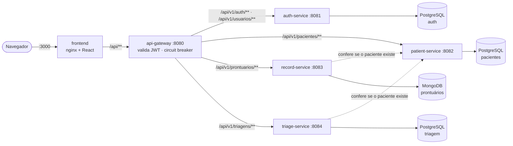

# 🏥 HealthSys Distribuído

[](docs/diagrams/arquitetura.md)
[](docker-compose.yml)
[](#)
[](#-status-da-sprint-2-semanas-34)

Plataforma de Gestão Hospitalar baseada em Arquitetura Distribuída, desenvolvida para apoiar hospitais no gerenciamento de pacientes, prontuários eletrônicos e triagens médicas com foco em alta disponibilidade e tolerância a falhas.

---

## 📁 Estrutura do Repositório

- **`docs/`**: Documentação técnica de arquitetura, diagramas (Arquitetura, Fluxo, Modelo de Dados) e relatórios.
- **`services/`**: Código-fonte de cada microsserviço independente (Spring Boot).
  - `api-gateway`: Ponto único de entrada da API (Spring Cloud Gateway): roteamento, validação de JWT e circuit breaker. ✅
  - `auth-service`: Cadastro de usuários, login e emissão de tokens JWT (PostgreSQL). ✅
  - `patient-service`: Gestão cadastral de pacientes (PostgreSQL). ✅
  - `record-service`: Prontuário eletrônico: consultas, exames e medicamentos (MongoDB). ✅
  - `triage-service`: Fila de triagem e classificação de risco (PostgreSQL). ✅ *O envio de eventos pelo Kafka entra nas semanas 5–6.*
  - `notification-service`: Notificações assíncronas (Kafka/WebSocket).
- **`frontend/`**: Aplicação cliente (React + Vite, servida por nginx). ✅ *Login, início por perfil, pacientes, ficha clínica, prontuário, fila de triagem e usuários.*
- **`infra/`**:
  - `docker/`: Configurações adicionais de containers.
  - `db/`: Scripts de inicialização automática de banco de dados (`postgres-auth-init`, `postgres-patient-init` e `mongo-init`; o banco da triagem é criado pelo `schema.sql` do próprio serviço).
  - `k8s/`: Manifests de deployment e serviços para Kubernetes.

---

## 🧭 Como as peças conversam



1. O usuário faz login: o **auth-service** confere a senha (BCrypt) e devolve um **token JWT** assinado (HS256, válido por 8 h) com o id, o nome e o **perfil** do usuário.
2. O frontend envia o token em todas as chamadas (`Authorization: Bearer <token>`).
3. O **api-gateway** barra na borda qualquer requisição sem token válido (exceto o login) e encaminha as demais para o serviço certo.
4. Cada microsserviço **valida o token de novo, localmente**, com o mesmo segredo (`JWT_SECRET`), e aplica as regras de perfil. Não há chamada ao auth-service a cada requisição, então o `patient-service` continua atendendo mesmo se o `auth-service` cair (sem ponto único de falha na autenticação).
5. O `record-service` e o `triage-service` perguntam ao `patient-service` se o paciente existe antes de gravar (REST, repassando o mesmo token). Cada serviço tem o seu banco (RNF09).
6. Se um serviço fica fora do ar, o **circuit breaker** do gateway (Resilience4j) responde `503` na hora, em vez de deixar o usuário esperando. Com 50% de falhas nas últimas 10 chamadas o circuito abre por 10 s, dando tempo para o serviço se recuperar.

### Permissões por perfil

Pensadas como num hospital: a recepção abre a ficha e coloca o paciente na fila, a enfermagem faz a triagem e aplica vacinas, o médico atende, pede exames e prescreve, e o dado clínico só é visto por profissionais de saúde (RN18, RNF17).

| Ação | ADMIN | RECEPCIONISTA | MEDICO | ENFERMEIRO |
| :--- | :---: | :---: | :---: | :---: |
| Gerenciar usuários (RF01) | ✅ | ❌ | ❌ | ❌ |
| Buscar pacientes e ver dados cadastrais (RF04) | ✅ | ✅ | ✅ | ✅ |
| Cadastrar e editar dados do paciente (RF03, RF05) | ❌ | ✅ | ❌ | ❌ |
| Excluir paciente (só se não tiver registros clínicos) | ✅ | ❌ | ❌ | ❌ |
| Ver histórico clínico, alergias, vacinas e atendimentos (RF07) | ❌ | ❌ | ✅ | ✅ |
| Registrar atendimento (RF06) | ❌ | ❌ | ✅ | ❌ |
| Registrar vacina aplicada (RF09) | ❌ | ❌ | ❌ | ✅ |
| Registrar alergia (RF08) | ❌ | ❌ | ✅ | ✅ |
| Registrar consulta no prontuário (RF10) | ❌ | ❌ | ✅ | ❌ |
| Solicitar exame (RF11) | ❌ | ❌ | ✅ | ❌ |
| Registrar resultado de exame (RF12) | ❌ | ❌ | ✅ | ✅ |
| Prescrever e suspender medicamento (RF13) | ❌ | ❌ | ✅ | ❌ |
| Abrir triagem (colocar o paciente na fila) | ❌ | ✅ | ❌ | ✅ |
| Ver a fila de triagem | ❌ | ✅ (sem sinais vitais) | ✅ | ✅ |
| Avaliar sinais vitais e classificar risco (RF15, RF16) | ❌ | ❌ | ❌ | ✅ |
| Chamar para atendimento e finalizar triagem | ❌ | ❌ | ✅ | ❌ |
| Cancelar triagem (ex.: paciente desistiu) | ❌ | ✅ | ✅ | ✅ |

As regras ficam no servidor (`SecurityConfig` de cada serviço); a tela só esconde o que o perfil não pode usar (`frontend/src/permissoes.js`).

---

## 🚀 Como Executar Localmente

Toda a stack (bancos, cache, monitoramento, backend e frontend) é containerizada. Não é preciso instalar banco de dados, Java, Maven ou Node.js na máquina: a compilação do backend e o build do frontend acontecem dentro do Docker.

### Pré-requisitos
- [Docker Desktop](https://www.docker.com/products/docker-desktop) instalado e em execução (Status: *Engine running*).
- Terminal (PowerShell, Bash ou CMD).

### 1. Iniciar os Serviços
Na raiz do repositório, execute o comando abaixo para montar as imagens e subir tudo em segundo plano:
```bash
docker compose up -d --build
```
> Na primeira execução o build leva alguns minutos (download das dependências Maven e npm). Os testes automatizados de cada serviço rodam durante o build; se algum falhar, a imagem não é gerada.

> **Bancos separados:** cada serviço tem o seu PostgreSQL. Se você já subiu uma versão anterior do projeto, rode `docker compose down -v --remove-orphans` antes de subir de novo (isso apaga os dados de teste).

### 2. Verificar o Status
Verificar se todos os containers subiram corretamente:
```bash
docker compose ps
```

### 3. Acessos e Credenciais

**Login padrão do sistema:** `admin@healthsys.com` / `admin123` (criado automaticamente pelo `auth-service`; pode ser alterado pelas variáveis `ADMIN_EMAIL` e `ADMIN_SENHA`).

| Serviço | Endereço | Usuário / Admin | Senha | Database Interno |
| :--- | :--- | :--- | :--- | :--- |
| **Frontend (Web)** | `http://localhost:3000` | `admin@healthsys.com` | `admin123` | - |
| **API Gateway** | `http://localhost:8080` | - | - | - |
| **Auth Service (API)** | `http://localhost:8081` · Swagger: `/swagger-ui.html` | - | - | `healthsys_auth` |
| **Patient Service (API)** | `http://localhost:8082` · Swagger: `/swagger-ui.html` | - | - | `healthsys_patients` |
| **Record Service (API)** | `http://localhost:8083` · Swagger: `/swagger-ui.html` | - | - | `healthsys_records` |
| **Triage Service (API)** | `http://localhost:8084` · Swagger: `/swagger-ui.html` | - | - | `healthsys_triage` |
| **PostgreSQL (auth)** | `localhost:5432` | `auth_user` | `auth_pass` | `healthsys_auth` |
| **PostgreSQL (pacientes)** | `localhost:5433` | `patient_user` | `patient_pass` | `healthsys_patients` |
| **PostgreSQL (triagem)** | `localhost:5434` | `triage_user` | `triage_pass` | `healthsys_triage` |
| **MongoDB** | `localhost:27017` | `mongouser` | `mongopass` | `healthsys_records` |
| **Redis** | `localhost:6379` | - | - | - |
| **Grafana** | `http://localhost:3001`| `admin` | `admin` | - |
| **Prometheus** | `http://localhost:9090`| - | - | - |

> **Portas:** o site usa a `3000` e o Grafana a `3001`. A `8080` é do API Gateway; os microsserviços são numerados a partir da `8081`.

> **Swagger:** abra `http://localhost:8081/swagger-ui.html`, execute o `POST /api/v1/auth/login`, copie o `token` e cole no botão **Authorize**. O mesmo token funciona no Swagger dos outros serviços (8082, 8083 e 8084).

> **Segredo do JWT:** o valor padrão serve só para desenvolvimento. Para trocar, crie um arquivo `.env` na raiz com `JWT_SECRET=<no mínimo 32 caracteres>`; o docker-compose repassa o mesmo valor a todos os serviços. Os containers Java usam o fuso `America/Sao_Paulo`, para que as datas e horas fiquem no horário de Brasília.

> *Dica: Utilizaremos ferramentas como **DBeaver** ou **MongoDB Compass** para visualizar os dados.*

### 4. Parar e Limpar os Serviços
Para pausar os containers temporariamente sem perder os dados:
```bash
docker compose down
```

**⚠️ Reset Completo:** Caso queiramos alterar os arquivos de inicialização (`init.sql` ou `init-mongo.js`) e recriar o banco do zero (apagando todos os dados), utilizaremos a flag `-v`:
```bash
docker compose down -v
```
No próximo `docker compose up -d`, os bancos serão recriados novinhos em folha.

---

## 🔌 API REST

Todas as rotas são acessadas pelo gateway (`http://localhost:8080`) ou pelo frontend (`http://localhost:3000`, repassado pelo nginx). Exceto o login, todas exigem o header `Authorization: Bearer <token>`.

Erros seguem o formato padrão RFC 7807 (*Problem Details*). Erros de validação trazem o campo `erros` com a mensagem de cada campo. `401` = token ausente/inválido/expirado; `403` = perfil sem permissão; `503` = serviço fora do ar (resposta do circuit breaker).

### 🔐 Autenticação (`auth-service`)

| Método | Rota | Acesso | Descrição | Sucesso | Erros |
| :--- | :--- | :--- | :--- | :--- | :--- |
| `POST` | `/api/v1/auth/login` | Público | Troca e-mail e senha por um token JWT | `200` | `400`, `401` credenciais inválidas |
| `GET` | `/api/v1/auth/me` | Autenticado | Dados do usuário dono do token | `200` | `401` |

```json
// POST /api/v1/auth/login
{ "email": "admin@healthsys.com", "senha": "admin123" }

// resposta
{
  "token": "eyJhbGciOiJIUzI1NiJ9...",
  "tipo": "Bearer",
  "expiraEm": "2026-11-05T02:00:00Z",
  "usuario": { "id": 1, "nome": "Administrador", "email": "admin@healthsys.com", "perfil": "ADMIN", "criadoEm": "..." }
}
```

### 👤 Usuários (`auth-service`, somente ADMIN)

| Método | Rota | Descrição | Sucesso | Erros |
| :--- | :--- | :--- | :--- | :--- |
| `POST` | `/api/v1/usuarios` | Cadastra um usuário | `201` + header `Location` | `400` dados inválidos, `409` e-mail já cadastrado |
| `GET` | `/api/v1/usuarios` | Lista todos os usuários | `200` | - |
| `GET` | `/api/v1/usuarios/{id}` | Busca um usuário | `200` | `404` |
| `PUT` | `/api/v1/usuarios/{id}` | Atualiza (senha opcional; nula mantém a atual) | `200` | `400`, `404`, `409` |
| `DELETE` | `/api/v1/usuarios/{id}` | Remove um usuário | `204` | `404`, `409` ao tentar excluir a si mesmo |

```json
{ "nome": "Dra. Ana Souza", "email": "ana@hospital.com", "senha": "senhaForte123", "perfil": "MEDICO" }
```

- `perfil` aceita `ADMIN`, `RECEPCIONISTA`, `MEDICO` ou `ENFERMEIRO`.
- E-mails são normalizados para minúsculas e devem ser únicos.
- Senhas têm de 8 a 72 caracteres e são gravadas apenas como hash **BCrypt**; nenhuma resposta da API devolve a senha.

### 🩺 Pacientes (`patient-service`)

| Método | Rota | Acesso | Descrição | Sucesso | Erros |
| :--- | :--- | :--- | :--- | :--- | :--- |
| `POST` | `/api/v1/pacientes` | RECEPCIONISTA | Cadastra um paciente | `201` + header `Location` | `400`, `409` CPF já cadastrado |
| `GET` | `/api/v1/pacientes?busca=` | Todos os perfis | Lista em ordem alfabética; `busca` filtra por trecho do nome ou início do CPF | `200` | - |
| `GET` | `/api/v1/pacientes/{id}` | Todos os perfis | Busca um paciente | `200` | `404` |
| `PUT` | `/api/v1/pacientes/{id}` | RECEPCIONISTA | Atualiza um paciente | `200` | `400`, `404`, `409` |
| `DELETE` | `/api/v1/pacientes/{id}` | ADMIN | Remove um cadastro sem registros clínicos | `204` | `403`, `404`, `409` paciente com prontuário |

```json
{
  "nome": "Maria da Silva",
  "cpf": "529.982.247-25",
  "dataNascimento": "1990-05-15",
  "sexo": "F",
  "telefone": "(85) 98888-0001",
  "email": "maria@email.com",
  "endereco": "Rua das Flores, 100 - Fortaleza/CE"
}
```

- Obrigatórios: `nome`, `cpf`, `dataNascimento` (formato `AAAA-MM-DD`, não pode estar no futuro) e `sexo` (`M`, `F` ou `O`).
- O CPF é aceito com ou sem pontuação, tem os dígitos verificadores conferidos, é gravado só com números e deve ser único.
- A resposta inclui a `idade`, calculada a partir da data de nascimento, e a `versao` do registro.
- No `PUT`, envie de volta a `versao` recebida. Se outra pessoa salvou o paciente antes, a API responde `409` e nada é gravado (RN54).

### 📋 Ficha clínica (`patient-service`, só MEDICO e ENFERMEIRO)

| Método | Rota | Quem registra | Descrição |
| :--- | :--- | :--- | :--- |
| `GET` | `/api/v1/pacientes/{id}/historico` | - | Atendimentos, vacinas e alergias juntos, do mais recente para o mais antigo (RF07) |
| `GET` / `POST` | `/api/v1/pacientes/{id}/alergias` | MEDICO e ENFERMEIRO | Alergias (RF08). Corpo: `{ "descricao": "Dipirona" }` |
| `GET` / `POST` | `/api/v1/pacientes/{id}/vacinas` | ENFERMEIRO | Vacinas aplicadas (RF09). Corpo: `{ "nomeVacina": "Hepatite B", "dataAplicacao": "2026-11-16", "dose": "1ª dose", "lote": "AB123" }` |
| `GET` / `POST` | `/api/v1/pacientes/{id}/atendimentos` | MEDICO | Atendimentos (RF06). Corpo: `{ "tipo": "CONSULTA", "data": "2026-11-16T09:30", "observacoes": "..." }` |

- `tipo` de atendimento: `CONSULTA`, `RETORNO`, `URGENCIA` ou `EMERGENCIA`. Datas não podem estar no futuro.
- Cada registro guarda quem registrou (nome e perfil, lidos do token) e quando.
- Registros de prontuário não são editados nem apagados: uma correção é um novo registro. Por isso um paciente com registros clínicos não pode ser excluído.

### 🗂️ Prontuário (`record-service`, só MEDICO e ENFERMEIRO veem)

Guardado no MongoDB, nas coleções `consultas`, `exames` e `medicamentos` (cada documento tem o `pacienteId`).

| Método | Rota | Quem registra | Descrição |
| :--- | :--- | :--- | :--- |
| `GET` | `/api/v1/prontuarios/{pacienteId}` | - | Consultas, exames e medicamentos do paciente de uma vez |
| `GET` / `POST` | `/api/v1/prontuarios/{pacienteId}/consultas` | MEDICO | Consultas (RF10). Corpo: `{ "data": "2026-11-16T09:30", "motivo": "Febre", "avaliacao": "...", "diagnostico": "...", "conduta": "..." }` |
| `GET` / `POST` | `/api/v1/prontuarios/{pacienteId}/exames` | MEDICO | Solicita exame (RF11). Corpo: `{ "nome": "Hemograma completo", "tipo": "LABORATORIAL", "observacoes": "..." }` |
| `PUT` | `/api/v1/prontuarios/{pacienteId}/exames/{exameId}/resultado` | MEDICO e ENFERMEIRO | Resultado (RF12). Corpo: `{ "resultado": "...", "dataResultado": "2026-11-16" }` |
| `GET` / `POST` | `/api/v1/prontuarios/{pacienteId}/medicamentos` | MEDICO | Prescrição (RF13). Corpo: `{ "nome": "Dipirona", "dosagem": "500 mg", "via": "ORAL", "frequencia": "de 6 em 6 horas", "dataInicio": "2026-11-16", "dataFim": "2026-11-20" }` |
| `PUT` | `/api/v1/prontuarios/{pacienteId}/medicamentos/{medicamentoId}/suspensao` | MEDICO | Suspende uma prescrição. Corpo: `{ "motivo": "..." }` |

- `tipo` de exame: `LABORATORIAL`, `IMAGEM` ou `OUTRO`. `via`: `ORAL`, `INTRAVENOSA`, `INTRAMUSCULAR`, `SUBCUTANEA`, `TOPICA`, `INALATORIA` ou `OUTRA`.
- Nada é apagado: o resultado de um exame é registrado uma única vez (`409` se já tiver) e um medicamento é suspenso com motivo, não excluído.
- Antes de gravar, o serviço confere no `patient-service` se o paciente existe (`404` se não existir, `503` se o serviço de pacientes estiver fora do ar).

### 🚑 Triagem (`triage-service`)

| Método | Rota | Acesso | Descrição |
| :--- | :--- | :--- | :--- |
| `POST` | `/api/v1/triagens` | RECEPCIONISTA, ENFERMEIRO | Coloca o paciente na fila. Corpo: `{ "pacienteId": 1, "queixaPrincipal": "Dor no peito há 1 hora" }` |
| `GET` | `/api/v1/triagens?status=&pacienteId=` | RECEPCIONISTA, ENFERMEIRO, MEDICO | Lista na ordem da fila (filtros opcionais) |
| `GET` | `/api/v1/triagens/{id}` | RECEPCIONISTA, ENFERMEIRO, MEDICO | Busca uma triagem |
| `PUT` | `/api/v1/triagens/{id}/avaliacao` | ENFERMEIRO | Sinais vitais e risco (RF15, RF16). Corpo: `{ "sintomas": "...", "pressaoArterial": "120/80", "temperatura": 37.8, "frequenciaCardiaca": 92, "saturacao": 97, "classificacaoRisco": "ALTO", "versao": 0 }` |
| `PUT` | `/api/v1/triagens/{id}/status` | conforme a regra abaixo | Muda o status. Corpo: `{ "status": "EM_ATENDIMENTO", "versao": 1 }` |

- Risco (RN38): `BAIXO`, `MEDIO`, `ALTO` ou `CRITICO`. Status (RN40): `PENDENTE`, `EM_ATENDIMENTO`, `FINALIZADA` ou `CANCELADA`.
- Caminhos permitidos: `PENDENTE → EM_ATENDIMENTO` (só MEDICO e só com risco classificado), `EM_ATENDIMENTO → FINALIZADA` (só MEDICO), `EM_ATENDIMENTO → PENDENTE` (devolver à fila) e `PENDENTE`/`EM_ATENDIMENTO → CANCELADA` (recepção, enfermagem ou médico). Triagem finalizada ou cancelada não muda mais (`409`).
- Um paciente só pode ter uma triagem ativa por vez (`409`).
- Ordem da fila: primeiro quem está em atendimento, depois quem ainda não foi classificado, depois do risco mais grave para o mais leve e, no empate, quem chegou antes.
- Como no cadastro de pacientes, envie a `versao` recebida: se outra pessoa mudou a triagem antes, a API responde `409` (RN54).
- A recepção vê a fila, mas a resposta não traz sintomas nem sinais vitais para esse perfil.

### Health checks
`GET /actuator/health` em cada serviço (`8080` a `8084`) — público.

---

## 📌 Status da Sprint 2 (Semanas 3–4)

| Item | Situação |
| :--- | :--- |
| Implementação do serviço de usuários | ✅ `auth-service`: CRUD de usuários com BCrypt e perfis |
| Implementação do serviço de pacientes | ✅ `patient-service`: CRUD de pacientes com validação de CPF e busca |
| Implementação do serviço de autenticação | ✅ Login com JWT, autorização por perfil em cada serviço |
| Criação da API REST | ✅ Rotas REST versionadas (`/api/v1`), erros RFC 7807, Swagger e API Gateway |
| Desenvolvimento inicial do frontend | ✅ Login, cadastro de pacientes e de usuários (React) |
| Ficha clínica e perfis por função | ✅ Recepcionista, médico e enfermeiro com papéis diferentes; alergias, vacinas e atendimentos |
| Prontuário e triagem (adiantados das semanas 5–6) | ✅ `record-service` (MongoDB) e `triage-service` (fila com classificação de risco). Falta o Kafka e as notificações |

**Entregáveis:** sistema com cadastro de usuários ✅ · sistema com cadastro de pacientes ✅ · primeira versão da interface web ✅
